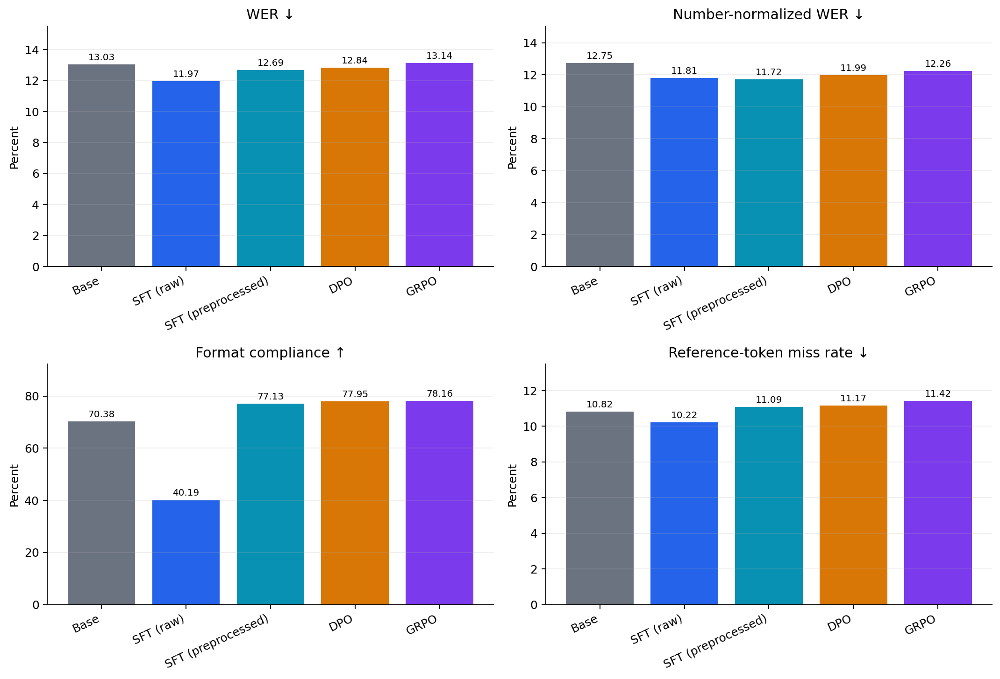
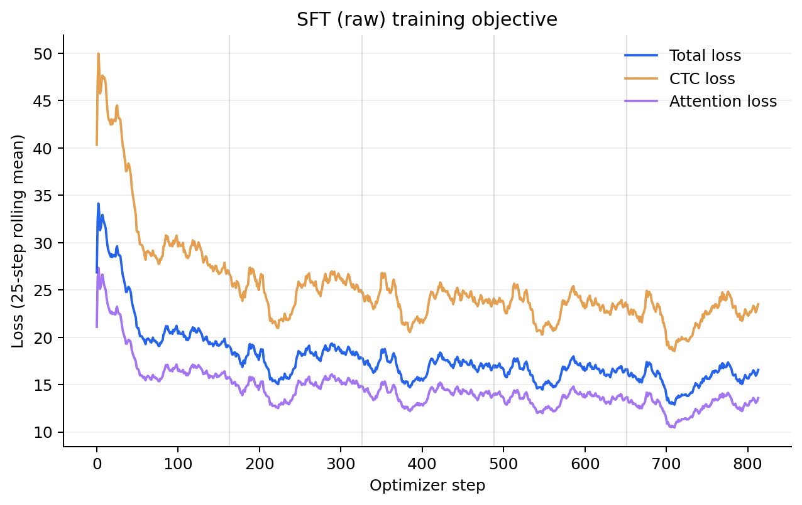
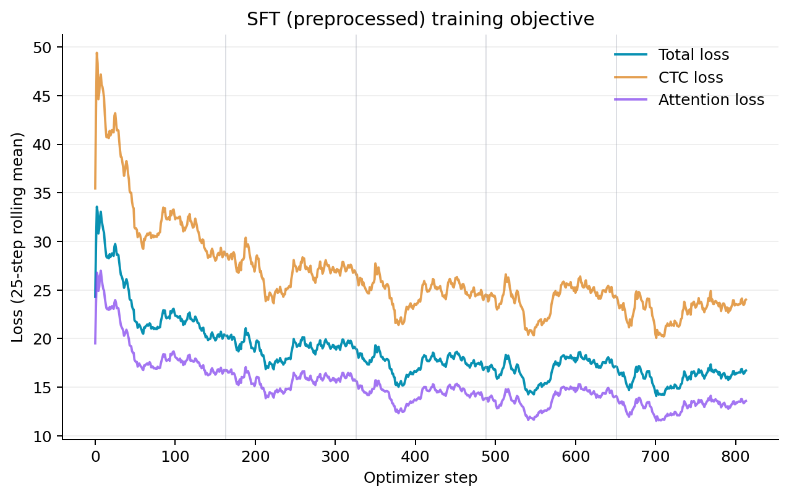
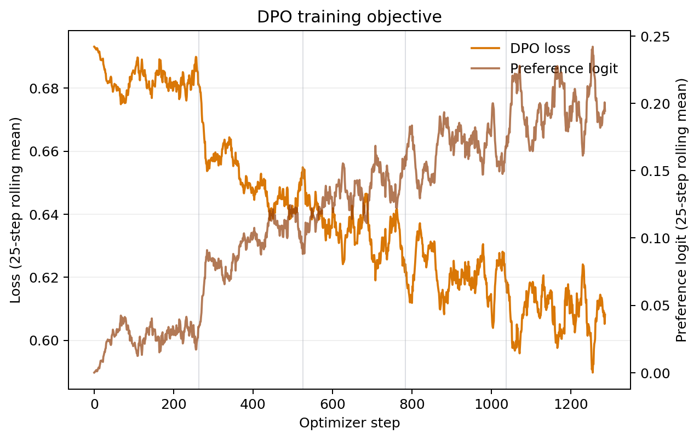
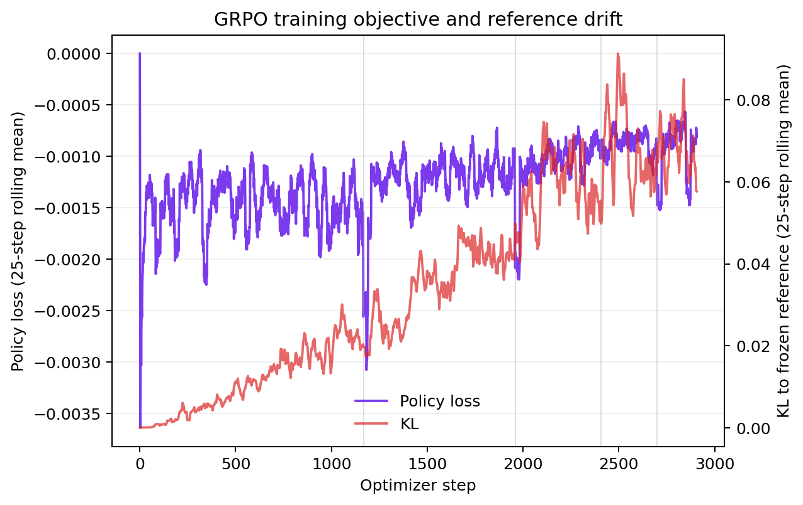
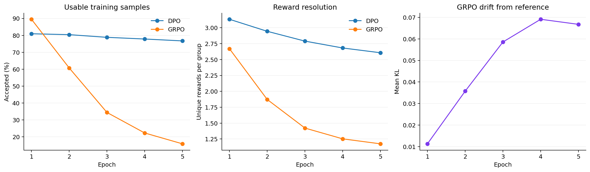
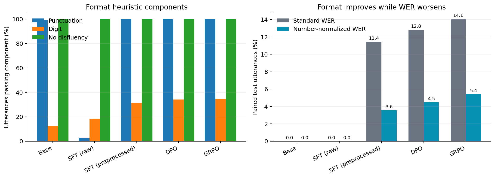

# FLEURS ASR post-training experiments

Date: 2026-11-13

## Scope

This report compares five OWSM v4 Base 102M systems on the same 647-utterance
FLEURS `en_us` test split:

1. frozen Base model;
2. SFT on the raw FLEURS transcripts;
3. SFT on deterministically preprocessed display-form transcripts;
4. DPO;
5. GRPO.

All fine-tuning runs use the full 2,602-utterance training split for five epochs.
The raw and preprocessed SFT runs use batch size 16. DPO and GRPO use batch size
8 and generate up to 16 hypotheses per utterance; GRPO performs four inner
optimization passes per accepted group.

## Evaluation metrics

- **WER:** current case- and punctuation-insensitive word error rate. Number
  words and digits are still different tokens (`thirty` != `30`).
- **Number-normalized WER:** post-hoc WER after applying the same deterministic
  inverse text normalization to reference and prediction. This separates
  content errors from spoken-form versus written-form number differences.
- **Format compliance:** the current three-part heuristic: no disfluency,
  punctuation present, and at least one digit.
- **Reference-token miss rate:** the metric currently named
  `harmful_edit_rate`. It measures missing unique reference tokens; it is not a
  semantic or hallucination metric.

## Main results

| Model | WER ↓ | Number-normalized WER ↓ | Format compliance ↑ | Reference-token miss ↓ |
|---|---:|---:|---:|---:|
| Base | 13.03% | 12.75% | 70.38% | 10.82% |
| **SFT (raw)** | **11.97%** | 11.81% | 40.19% | **10.22%** |
| **SFT (preprocessed)** | 12.69% | **11.72%** | 77.13% | 11.09% |
| DPO | 12.84% | 11.99% | 77.95% | 11.17% |
| GRPO | 13.14% | 12.26% | **78.16%** | 11.42% |



### Paired-bootstrap interpretation

All confidence intervals below are paired over the same 647 test utterances.

- Raw SFT improves standard WER over Base by 1.06 percentage points (95% CI:
  0.56 to 1.57 points), but loses 30.19 points of format compliance.
- Preprocessed SFT improves number-normalized WER over Base by 1.03 points
  (95% CI: 0.56 to 1.51 points) and improves format compliance by 6.75 points.
  Its standard-WER improvement over Base is 0.34 points and is not significant.
- DPO and GRPO both improve number-normalized WER over Base, but their standard
  WER differences are not significant.
- Preprocessed SFT has significantly better standard and number-normalized WER
  than GRPO (0.45 and 0.53 points respectively), while GRPO has 1.03 points
  higher format compliance.
- Preprocessed SFT and DPO are statistically tied on both WER variants; DPO has
  0.82 points higher format compliance.
- Compared with raw SFT, preprocessed SFT has 0.73 points worse standard WER,
  statistically equivalent number-normalized WER, and 36.94 points better
  format compliance.

The most useful practical comparison is therefore **preprocessed SFT versus
DPO**: their accuracy is statistically tied, their format scores differ by less
than one point, and SFT does not require preference-pair generation or an RL
objective.

## Training curves

The vertical gray lines mark epoch boundaries; every curve is shown as a
25-step rolling mean.

### Loss definitions

The losses plotted here follow the actual trainer implementations and resolved
model configuration:

- **SFT:** OWSM uses a hybrid CTC/attention objective:

  $$
  L_{\mathrm{SFT}} = 0.3L_{\mathrm{CTC}} + 0.7L_{\mathrm{att}}.
  $$

  $L_{\mathrm{CTC}}$ trains monotonic audio-to-token alignment, while
  $L_{\mathrm{att}}$ is the autoregressive decoder's token loss (with label
  smoothing 0.1). The SFT figures show both unweighted component losses and
  their weighted total. Raw and preprocessed SFT use the same equation; only
  their target transcripts differ.

- **DPO:** for a chosen transcript $y_w$, rejected transcript $y_l$, trainable
  policy $\pi_\theta$, and frozen reference policy $\pi_{\mathrm{ref}}$, define

  $$
  \Delta_\theta = \log \pi_\theta(y_w|x)-\log \pi_\theta(y_l|x), \qquad
  \Delta_{\mathrm{ref}} = \log \pi_{\mathrm{ref}}(y_w|x)-\log \pi_{\mathrm{ref}}(y_l|x),
  $$

  $$
  L_{\mathrm{DPO}}=-\log\sigma\!\left(0.1(\Delta_\theta-\Delta_{\mathrm{ref}})\right).
  $$

  The plotted preference logit is the value inside $\sigma$. A larger positive
  logit means the policy prefers the chosen transcript more strongly than the
  frozen reference does. DPO has no separately added KL term here; closeness to
  the reference is imposed implicitly through $\Delta_{\mathrm{ref}}$.

- **GRPO:** the reward for hypothesis $i$ is
  $r_i=F_i-1.5\max(\mathrm{WER}_i,0)$, where $F_i$ is format compliance. Rewards
  within each 16-hypothesis group are standardized into
  $A_i=(r_i-\bar r)/(s_r+10^{-6})$. With
  $\rho_i=\exp(\log\pi_\theta-\log\pi_{\mathrm{old}})$ and clipping range
  $[0.8,1.2]$,

  $$
  L_{\mathrm{policy}}=-\operatorname{mean}_i\left[
  \min\left(\rho_iA_i,\operatorname{clip}(\rho_i,0.8,1.2)A_i\right)\right],
  $$

  $$
  L_{\mathrm{GRPO}}=L_{\mathrm{policy}}+0.01D_{\mathrm{KL}}.
  $$

  The GRPO figure plots $L_{\mathrm{policy}}$ and the measured KL separately;
  the optimized total is their sum with the 0.01 KL coefficient. Losses are
  then averaged across hypotheses/groups and the audio examples in each batch.

### Raw-target SFT



### Preprocessed-target SFT



The two SFT runs are separated because their target tokenizations differ, so
their absolute losses should not be interpreted as a direct accuracy ranking.

| Epoch | Raw SFT loss | Raw accuracy | Preprocessed loss | Preprocessed accuracy |
|---:|---:|---:|---:|---:|
| 1 | 21.46 | 0.876 | 22.59 | 0.873 |
| 2 | 17.68 | 0.899 | 18.89 | 0.897 |
| 3 | 16.91 | 0.904 | 17.36 | 0.904 |
| 4 | 16.32 | 0.907 | 16.90 | 0.907 |
| 5 | 15.54 | 0.911 | 15.97 | 0.913 |

Both SFT runs converge normally.

### DPO



DPO loss decreases from an epoch mean of 0.682 to 0.608, while its preference
logit increases from 0.028 to 0.198. The accepted-pair rate remains relatively
stable, declining from 80.9% to 76.7%. The optimizer is learning the specified
preferences rather than remaining at the initial `log(2)` loss.

### GRPO



GRPO mean KL from the frozen reference rises from 0.011 to 0.067, while the
mean reward rises from 0.585 to 0.670. However, the percentage of groups with a
usable reward difference collapses from 89.5% in epoch 1 to 15.8% in epoch 5.
The average number of unique reward values per group similarly falls from 2.67
to 1.17 even though the model still generates about 16 textual hypotheses.



This is primarily a **reward-resolution collapse**, not proof that all textual
hypotheses became identical. The current discrete reward can no longer
distinguish most candidates late in training, so GRPO discards most samples and
receives progressively less useful learning signal.

## Reward hacking and proxy optimization

There is evidence of proxy optimization, especially in the digit component.



| Model | Punctuation present | Digit present |
|---|---:|---:|
| Base | 98.92% | 12.36% |
| SFT (raw) | 2.78% | 17.93% |
| SFT (preprocessed) | 100.00% | 31.53% |
| DPO | 99.85% | 34.16% |
| GRPO | 100.00% | 34.62% |

The no-disfluency component is 99.85% for every system and provides almost no
training signal. Punctuation is already 98.92% for Base. As a result, the
easiest way to increase format compliance is to emit any digit, regardless of
whether it is the correct number or whether a digit is appropriate.

Using ordinary WER, format improves while WER worsens on 11.4% of preprocessed
SFT examples, 12.8% of DPO examples, and 14.1% of GRPO examples. This overstates
reward hacking because valid ITN changes are counted as word errors. After
number normalization, the rates fall to 3.6%, 4.5%, and 5.4% respectively.
The remaining DPO/GRPO cases are stronger evidence of genuine content
regression selected alongside a higher proxy score.

Example:

```text
Reference: prides are made up of one to three related adult males ... thirty females
Base:      Prides are made up of one to three related adult males ... thirty females.
SFT-prep:  prides are made up of 1-2-3 related adult males ... 30 females.
DPO:       Prides are made up of 1 2 3 related adult males ... 30 females.
GRPO:      Prides are made up of 1, 2, 3 related adult males ... 30 females.
```

All three display-form systems convert the acoustically ambiguous `to` into the
digit `2`. The format heuristic awards the digit but does not verify the number
span. This is not solved by replacing RL with preprocessing; it requires a
reference-aware number/entity metric and a stronger ITN implementation.

Another example shows the benefit of target preprocessing without sacrificing
lexical recovery:

```text
Reference: it is thinner under the maria and thicker under the highlands
Base:      It is thinner under the highlands.
SFT-raw:   it is thinner under the maria and thicker under the highlands
SFT-prep:  it is thinner under the maria and thicker under the highlands.
DPO:       It is thinner under the highlands.
GRPO:      it is thinner, under the, Maria, and thicker, under the highlands.
```

Preprocessed SFT preserves raw SFT's recovered content and adds the desired
terminal punctuation. GRPO also recovers the content here but inserts excessive
commas, which the current punctuation heuristic cannot penalize.

## Why the current harmful-edit metric is not useful

The metric has a 0.915–0.927 correlation with WER across these systems and adds
little independent information. Because it uses sets of normalized words, it
ignores order, repetition, and inserted hallucinations. There are predictions
with nonzero WER but a zero harmful-edit score because every unique reference
token appears somewhere in the prediction.

Recommendation:

- remove it from the headline table or rename it to
  `reference_token_miss_rate`;
- report insertion, deletion, and substitution rates separately;
- add reference-aware number/entity accuracy and hallucinated-entity rate;
- use a semantic score only as a secondary diagnostic, since semantic metrics
  can also hide important name and number errors.

## Preprocessed-SFT experiment

The new transform is deliberately deterministic and auditable:

1. preserve all non-number gold-reference tokens;
2. convert unambiguous English cardinal, ordinal, year, and decade number-word
   spans to written forms;
3. append terminal punctuation;
4. do not infer commas or capitalization;
5. apply the transform only to the training split; evaluate against the
   original FLEURS references.

It changes 2,594 of 2,602 training targets, mostly by appending a period. The
transformed training targets contain digits in 28.8% of utterances. The test
predictions contain digits in 31.5%, compared with 34.2–34.6% for DPO/GRPO.

This experiment succeeds as a stronger SFT baseline: it reaches nearly the same
format score as DPO/GRPO, obtains the best number-normalized WER, and avoids the
GRPO reward-resolution failure. Its remaining weaknesses are number-span
ambiguity (`to` versus `two`), time formatting (`11:35`), and the absence of a
real punctuation-restoration model.

## Conclusions

1. Raw SFT remains best under the original lexical WER, but its unformatted
   targets make the format comparison unfair.
2. Preprocessed SFT is the strongest overall accuracy/format tradeoff in this
   experiment and is statistically tied with DPO on both WER variants.
3. DPO successfully learns its preferences but gains little over the much
   simpler preprocessed-SFT baseline.
4. GRPO obtains the highest heuristic format score but has the weakest accuracy
   among the trained systems and loses reward resolution across epochs.
5. The current format reward is too coarse. The next iteration should use
   reference-aware number equivalence, entity preservation, and punctuation
   precision/recall rather than rewarding the mere presence of digits or commas.
6. The current harmful-edit metric should not be treated as semantic safety.

## Reproduction and artifacts

- New config: `configs/sft_preprocessed_full.yaml`
- Target transform: `data_prep/text_preprocessing.py`
- Analysis script: `scripts/analyze_fleurs_experiments.py`
- New output: `outputs/sft_preprocessed_full_v1/`
- Machine-readable summary: `reports/fleurs_v3/metrics_summary.json`

Run the new experiment:

```bash
.venv/bin/python scripts/run_sft.py \
  --config configs/sft_preprocessed_full.yaml \
  --stage all
```

Regenerate all figures and the JSON summary:

```bash
.venv/bin/python scripts/analyze_fleurs_experiments.py \
  --output-dir reports/fleurs_v3
```
